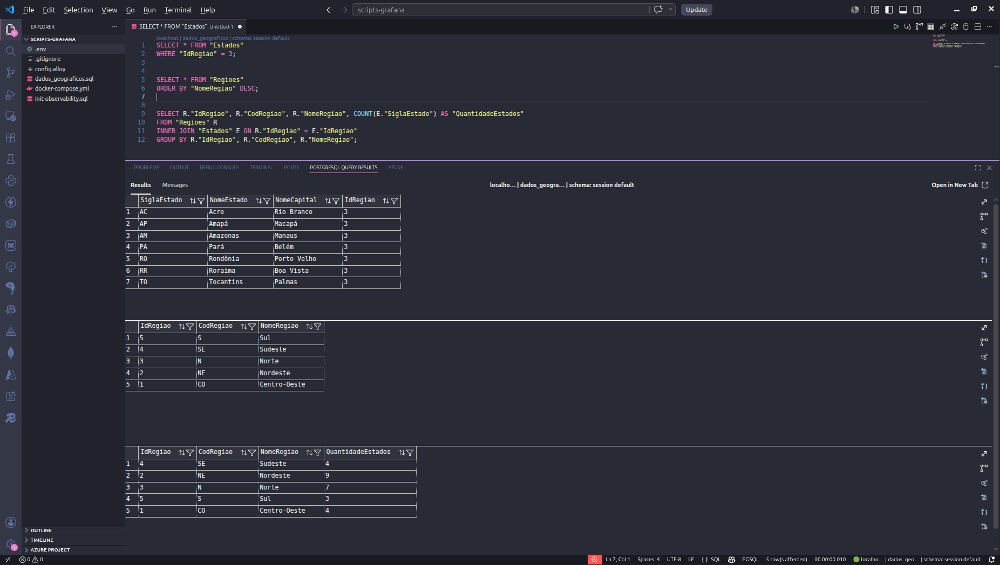
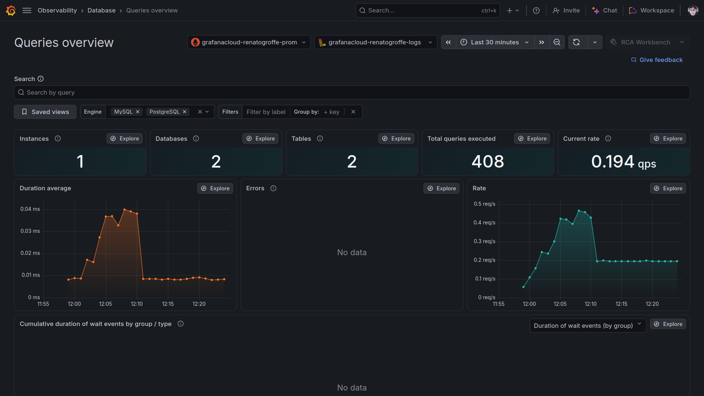
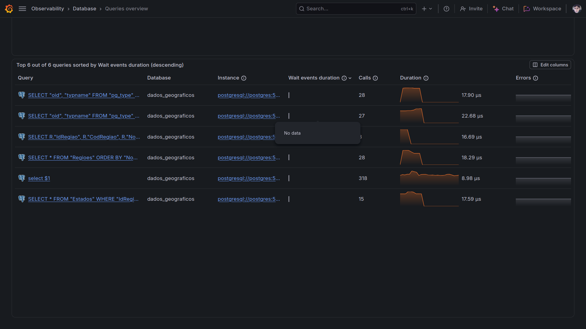
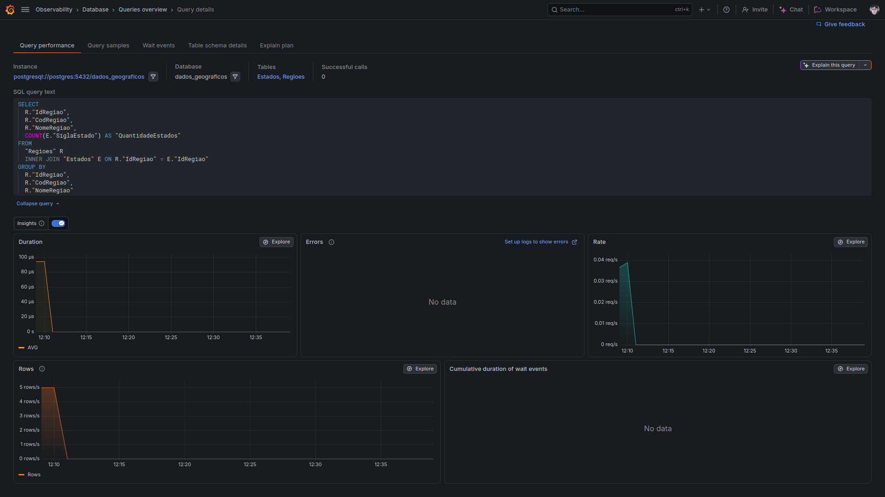

# grafana-alloy-prometheus-loki-postgres-dockercompose_dadosgeograficos
Script do Docker Compose para criação de uma base PostgreSQL com dados geográficas (Estados e Regiões do Brasil), com a coleta de métricas (Prometheus) + logs (Loki) via Grafana Alloy e consulta destas informações através da funcionalidade Queries overview (Database Observability) a partir do Grafana Cloud.

## Testes

Queries executadas:

```sql
SELECT * FROM "Estados"
WHERE "IdRegiao" = 3;


SELECT * FROM "Regioes"
ORDER BY "NomeRegiao" DESC;


SELECT R."IdRegiao", R."CodRegiao", R."NomeRegiao", COUNT(E."SiglaEstado") AS "QuantidadeEstados"
FROM "Regioes" R
INNER JOIN "Estados" E ON R."IdRegiao" = E."IdRegiao"
GROUP BY R."IdRegiao", R."CodRegiao", R."NomeRegiao";
```

Resultado no VS Code:



A funcionalidade **Queries overview** no Grafana Cloud:





Detalhes de uma das queries:

